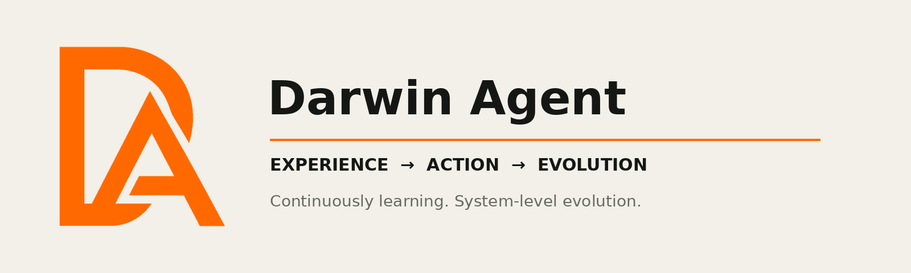

# Darwin Agent

**Experience → Action → Evolution**

Building continuously learning, self-evolving agent systems across digital and physical worlds.

经验沉淀形成行动，行动反馈推动进化。

[Team website](https://darwin-agent.github.io/) · [Research agenda](https://darwin-agent.github.io/#research) · [Selected work](https://darwin-agent.github.io/#work) · [Repositories](https://github.com/orgs/Darwin-Agent/repositories)

## Our Mission

An agent should not lose everything it learns when an interaction ends. We study how agents accumulate experience, turn it into effective action, and use feedback to improve the entire system—not only the underlying model.

Our research connects memory, executable harnesses, world models, learning from feedback, collective intelligence, and embodied intelligence in one continuous learning loop. Proposed changes must be evaluated before adoption.

## Research Directions

| Direction | Focus | Explore |
| --- | --- | --- |
| **Experience & memory** | Preserve, retrieve, reflect on, and govern experience as reusable knowledge. | [Mi-Memory](https://github.com/Darwin-Agent/Mi-Memory) |
| **Harness evolution** | Make prompts, tools, control flow, and execution frameworks composable, testable, and evolvable. | [HarnessX](https://github.com/Darwin-Agent/HarnessX) |
| **World modeling & action learning** | Learn environment dynamics from interactions to support prediction, simulation, and action learning. | [WIA](https://darwin-agent.github.io/WIA/) · [World-model survey](https://github.com/Darwin-Agent/awesome-world-models-for-digital-agents) |
| **Learning from feedback** | Turn trajectories and failure analysis into evaluated improvements and reusable skills. | [CAR-bench TRACE](https://github.com/Darwin-Agent/Car-bench-TRACE) |
| **Collective intelligence** | Study collaboration, communication, and higher-order interaction structure in agent societies. | [Topological Collapse](https://github.com/Darwin-Agent/topological-collapse-agent-societies) |
| **Embodied intelligence** | Connect perception, reasoning, and action through executable programs that evolve from physical rollout feedback. | [HarnessPAI](https://darwin-agent.github.io/HarnessPAI/) |

## Selected Open Research

| Project | What it explores | Resources |
| --- | --- | --- |
| **HarnessX** | A harness foundry built from reusable processors and bundles, paired with models and evolved through training. | [Code](https://github.com/Darwin-Agent/HarnessX) |
| **Mi-Memory** | A composable, evolvable, multi-source memory system for daily assistant agents. | [Code](https://github.com/Darwin-Agent/Mi-Memory) |
| **WIA** | World modeling and action learning across digital environments. | [Website](https://darwin-agent.github.io/WIA/) · [Code](https://github.com/Darwin-Agent/WIA) · [Demos](https://darwin-agent.github.io/WIA/demos.html) |
| **HarnessPAI** | An evolving executable harness for Physical AI. | [Website](https://darwin-agent.github.io/HarnessPAI/) · [Code](https://github.com/Darwin-Agent/HarnessPAI) · [Paper](https://arxiv.org/abs/2609.29166) |
| **CAR-bench TRACE** | Trajectory-driven skill-bank evolution for in-car agents. | [Code & report](https://github.com/Darwin-Agent/Car-bench-TRACE) |
| **Topological Collapse** | How higher-order interaction structure constrains collective intelligence. | [Code & reproducibility](https://github.com/Darwin-Agent/topological-collapse-agent-societies) |
| **Digital Agents Meet World Models** | A survey and curated research map for world models in digital-agent environments. | [Survey & collection](https://github.com/Darwin-Agent/awesome-world-models-for-digital-agents) |

## Our Identity

**D surrounds A; A reaches outward.** Our shared monogram expresses one system that learns and acts:

- **D — Darwin:** a stable spine and enclosing arc represent accumulated experience, memory, and feedback.
- **A — Agent:** an outward-reaching, upward-pointing form represents action and continued evolution.
- **Connection & negative space:** the letters share a connection while remaining distinguishable, linking learning and action without losing clarity.

The identity spans the team's research directions rather than representing a single project. Our primary brand color is orange, `#FF6900`.

## Build With Us

Explore our [open-source projects](https://github.com/orgs/Darwin-Agent/repositories), contribute to a relevant repository, or open a project issue to discuss research and engineering ideas.

The official team website is **[darwin-agent.github.io](https://darwin-agent.github.io/)**, maintained under the Darwin-Agent organization.
